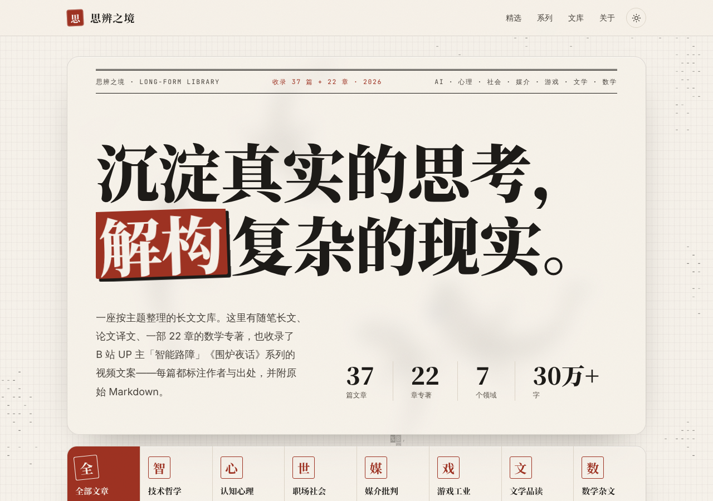

# 思辨之境 · 长文文库

> 线上地址：[https://yule1048596-art.github.io](https://yule1048596-art.github.io)

Yule 的个人长文文库，按主题整理 AI 与技术哲学、认知心理、职场社会、媒介批判、游戏工业、文学品读与数学杂文七个领域的文章。收录随笔长文、论文译文、22 章的《积和式》数学专著，以及 B 站 UP 主「智能路障」《围炉夜话》系列的视频文案；每篇文章页都标注作者与原始出处。



## 功能

- **首页**：海报式标题与领域目录、滚动标题带、精选文章、系列（任天堂三部曲、《不哭不哭，痛痛飞走吧》读后感四部曲、《积和式》专著、《围炉夜话》）、摘句、按领域分组的全部文章目录（22 章专著折叠为一行，可展开）
- **筛选与搜索**：按领域筛选、按系列筛选，即时搜索标题、标签、作者与摘要（按 `/` 聚焦搜索框）
- **阅读页**：直接渲染 Markdown，带自动目录与当前章节高亮、阅读进度、字号调节、系列导航、上一篇/下一篇、同领域推荐；支持表格、图片说明和 KaTeX 数学公式（含 `align`、`\tag`、`\boxed`）
- **Obsidian 语法**：`[[双链]]` 会转换成站内链接，`> [!info]`、`> [!tip]` 等 callout 渲染为彩色提示框（定理、例、练习、证明等），未上传的 `![[附件]]` 会显示占位提示
- **深色模式**：跟随系统，也可手动切换并记忆
- **首页背景**：开源 ASCII 鲨鱼动画 [ascii-sharks](https://github.com/stackedlol/ascii-sharks)（MIT），页面内容以半透明毛玻璃面板悬浮其上；浅色、深色各有一套配色，开启“减少动态效果”时显示静止画面，性能不足的设备会自动关闭模糊

## 目录结构

```
index.html              首页
article_detail.html     阅读页（article_detail.html?file=<文件名>.md）
404.html                404 页面
articles.json           文章索引（由脚本生成）
articles/               Markdown 原文、图片与 PDF
杂文短文(数学类)/        Obsidian 导出的多章节作品（每个子文件夹是一个系列）
assets/style.css        样式
assets/site.js          主题切换与文库公共函数
assets/vendor/          marked 12.0.2、KaTeX 0.16.11、ascii-sharks（本地化，不依赖 CDN）
assets/ocean-bg.js      首页背景动画的启动与主题同步
tools/ascii-sharks/     背景动画的源码（含改动说明与编译命令）
tools/build_index.py    重新生成 articles.json
```

## 添加或修改文章

1. 把 Markdown 文件放进 `articles/`。图片放在同一目录，用相对路径引用（如 ``），说明文字会显示为图注。
2. 运行索引脚本：

   ```bash
   python3 tools/build_index.py
   ```

   脚本会读取 YAML front matter（`title`、`author`、`url`、`duration`、`tags`）或第一个 `# 标题`，自动生成摘要、字数和阅读时间。
3. 新文件的领域默认为“未分类”，在 `articles.json` 里把它的 `category` 改成已有的领域名称即可；之后再运行脚本，已有的领域设置会保留。
4. 首页精选篇目在 `index.html` 顶部的 `FEATURED` 数组里修改，摘句在 `QUOTES` 数组里修改。

### 多章节作品（如《积和式》）

`tools/build_index.py` 顶部的 `COLLECTIONS` 列出这类文件夹及其所属领域（目前是 `杂文短文(数学类)` → 数学杂文）。文件夹里每个子文件夹 `N.名称` 是一个系列，`NN-标题.md` 是第 NN 章，`00-章节索引.md` 作为目录页会被跳过。新增章节或新的子文件夹后，同样运行一次 `python3 tools/build_index.py` 即可。

## 本地预览

页面通过 `fetch` 读取 `articles.json` 和 Markdown，需要用本地服务器打开（直接双击 HTML 文件会载入失败）：

```bash
python3 -m http.server 8000
```

然后访问 http://localhost:8000 。

## 版权

原创内容遵循 [CC BY-NC-SA 4.0](https://creativecommons.org/licenses/by-nc-sa/4.0/deed.zh) 协议。《围炉夜话》文案版权归 UP 主「智能路障」所有，《LLMs can't jump》原文版权归 Tom Zahavy 所有。
