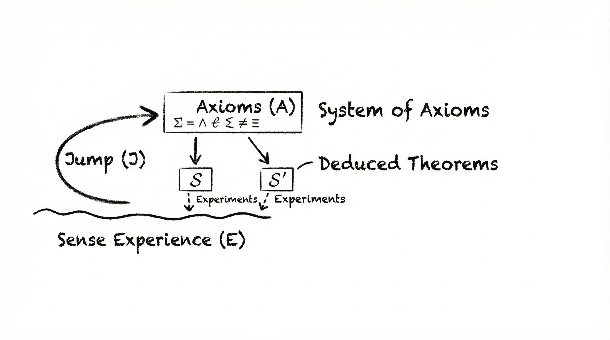
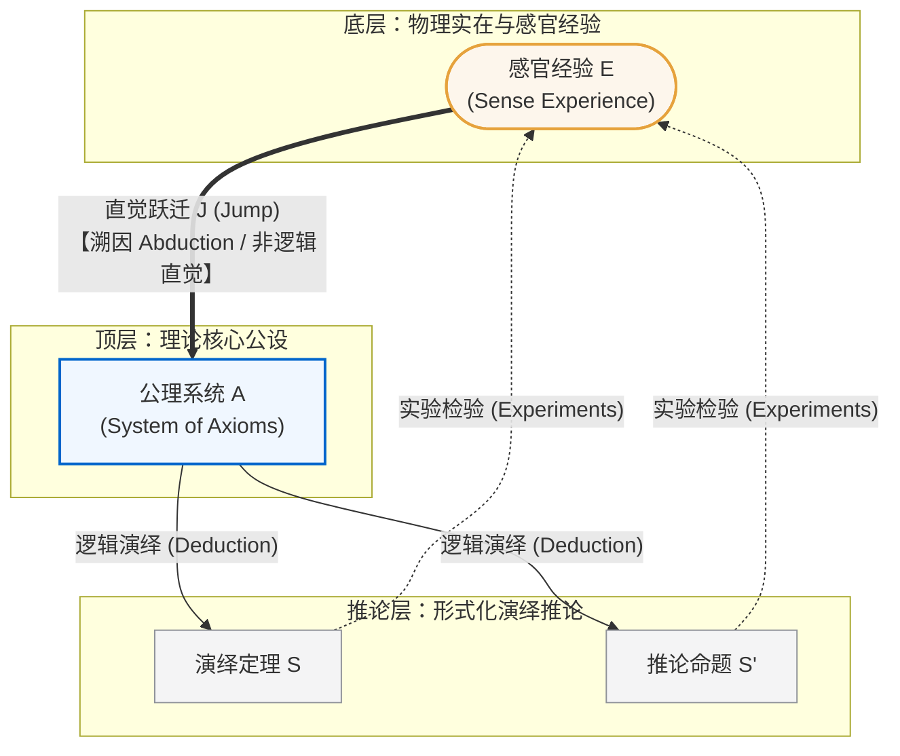
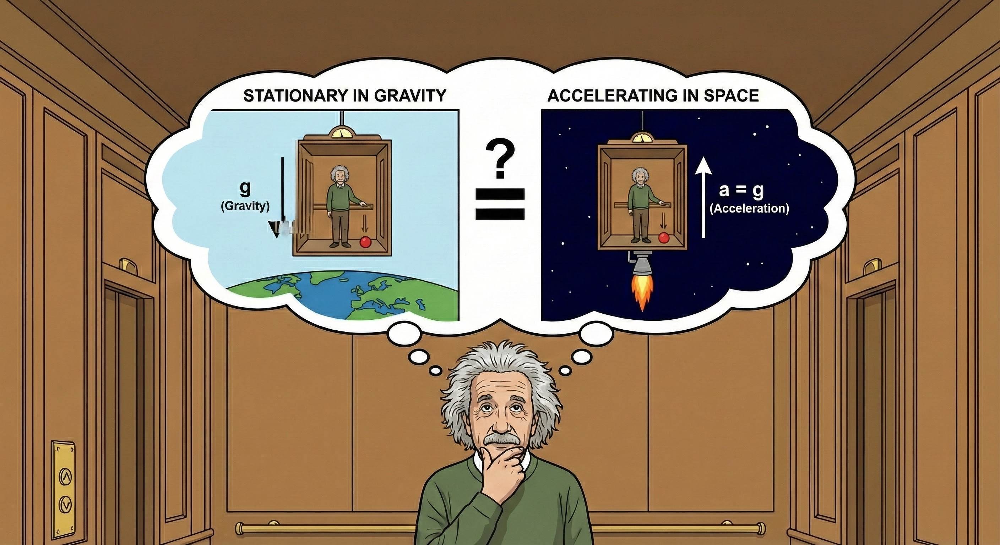

# LLMs can't jump（大语言模型无法起跳）

**原作者**：Tom Zahavy（Google DeepMind）  
**发表时间**：2026年1月27日  
**会议/收录**：ICML 2026 Position Paper Track / PhilSci-Archive (28024) / OpenReview (klU4737opt)  

---

## 摘要（Abstract）

我们究竟是如何从根本上发现新事物的？在写给莫里斯·索洛文（Maurice Solovine）的一封信中，阿尔伯特·爱因斯坦将科学发现构想为一个循环过程：包含从**感官经验**到**公理体系**的直觉“跃迁”（Jump），随后进行**逻辑演绎**。

尽管生成式人工智能已经掌握了**归纳法**（统计模式匹配），并且正在迅速攻克**演绎法**（形式化定理证明），但我们认为它仍然缺乏**溯因法（Abduction）**的机制——即生成全新解释性假说的能力。

本文以爱因斯坦构建广义相对论的过程作为计算案例研究，证明了当下流行的“**创造力即数据压缩**”（归纳）理论，在观测数据稀缺的重大科学发现场景中完全失效。本立场论文指出：虽然现代大语言模型（LLM）完全有能力在已知公理前提下执行证明定理的演绎阶段，但它在结构上根本无法完成提出这些公理所需的溯因“飞跃（Jump）”。

我们认为，将物理仿真转化为形式化公理是当前机器进行科学发明的核心瓶颈；具备物理自洽性的多模态世界模型（World Models），有望为跨越这一认知鸿沟提供不可或缺的感官基底。

---

## 1. 引言（Introduction）

科学发明所需的认知飞跃究竟具有何种特征？在当前 AI 界，一种极具代表性的观点（特别是由 Schmidhuber 于 2008 年倡导的学说）认为：科学发现本质上是一个**数据压缩问题**——即寻找一个能够简明扼要解释所有观察结果的最简程序。这种观点内在地将科学发现定性为**归纳推理（Induction）**：基于统计频率从观察中提炼普遍规则。与此同时，AlphaProof 等系统在国际数学奥林匹克（IMO）级别题目上的成功表明，AI 正在逐步征服**演绎推理（Deduction）**：从既定前提中进行形式化定理推导。

如果科学发现仅仅是这两部分的叠加，那么从理论上讲，只要给予足够的算力，现代大语言模型就理应有能力独立发明出像“广义相对论”这样的理论。

在本文中，我们以爱因斯坦构建广义相对论的历史过程作为计算案例研究，质疑了这种还原论前提。借助爱因斯坦的循环发现模型（如图 1 所示）：认识过程从**感官经验（$E$）**出发，通过概念上的**跃迁（$J$）**到达**公理系统（$A$）**，随后对推论进行逻辑演绎与实验验证。我们承认：如果直接把爱因斯坦的公设作为先验输入给现代 LLM，它很可能完成后续的数学演绎工作；但**提出公理本身**依然是机器无法跨越的瓶颈。

历史事实表明，当时实验数据的极度匮乏使得“统计归纳”根本无法解释相对论的产生；而公理作为推导的前提，本身又绝不可能通过演绎得出。因此，科学发现必然依赖于超出归纳与演绎之外的第三种认知机制——**溯因推理（Abduction）**。

为了形式化这一概念，我们采纳查尔斯·桑德斯·皮尔士（Charles Sanders Peirce）的经典逻辑框架。皮尔士根据规则（Rule，函数定义）、案例（Case，输入参数）与结果（Result，返回值）的三元置换来定义推理：

* **演绎（Deduction：规则 + 案例 $\to$ 结果）**：将一般规则应用于具体案例以预测结果的分析过程。它是唯一能确保真理性的推理（类似于执行已知代码并验证输出）。
* **归纳（Induction：案例 + 结果 $\to$ 规则）**：从大量案例与结果的积累中合成出一般规则的综合过程。它通过统计频率验证假设（类似于根据一组单元测试用例自动合成函数）。
* **溯因（Abduction：规则 + 结果 $\to$ 案例 / 全新规则）**：在遇到出人意料的异质结果时，反向推断最合理的解释案例或构建全新的规则假设。

与保证逻辑必然性的演绎不同，也与在现有数据流形中寻找模式的归纳不同，**溯因是一种创造性飞跃，旨在为一个反常现象发明其底层原因**。关键在于，爱因斯坦是通过**具身仿真（Embodied Simulation）**——即利用思想实验将抽象数学符号牢牢锚定在物理感受之中——从而在根本不存在符号先例的地方构想出了全新的公理体系。

## 2. 物理学背景与历史复盘（Background）

### 2.1 经典力学的巅峰与裂隙（Mechanics）

在19世纪，力学被视为整个物理学的基石。通过偏微分方程，科学家成功解释了声波传播、流体力学、离散质点运动乃至气体动理论（将黏度、热传导与扩散统一）。彼时，就连光也被纳入这一机械框架，被理解为在一种名为“以太”的介质中传播的机械波。

然而，机械世界观随后出现了根本性裂痕：麦克斯韦、法拉第、赫兹与马赫的工作将电磁规律统一为麦克斯韦方程组。牛顿力学无法解释电磁场，宣告了单一力学范式统治的终结。物理学被撕裂为两个互不相容的概念范式：**具有超距相互作用的离散质点**与**连续分布的场**。爱因斯坦无法接受这种割裂，立志建立一个能彻底取代超距作用的引力场理论。

与此同时，迈克尔逊-莫雷实验测定地球相对于以太的运动彻底失败，更震惊地发现光速并不随地球的公转而改变。当时物理学界为了修补以太假说，提出了愈发繁复牵强的附加解释（如“以太风”）。

更关键的是，牛顿引力理论在经验观测上极其精确。伽利略关于自由落体加速度与质量无关的发现被牛顿通过单摆实验验证：
$$
F_{\text{grav}} = m_i \frac{d^2 x}{dt^2} = m_g g
$$
若惯性质量等于引力质量（$m_i = m_g$），则加速度为恒量 $\frac{d^2 x}{dt^2} = g$。牛顿将比值 $\frac{m_i}{m_g} = 1$ 的精度验证到了 $10^{-3}$，拉普拉斯提升至 $10^{-7}$，厄特沃什（Eötvös）更是测到了 $10^{-9}$ 的惊人精度。在整个天文学界，唯一的已知反常现象仅有水星近日点每世纪几十角秒的进动（勒维耶，1845）。当时科学界对牛顿定律坚信不疑，普遍认定太阳附近必定隐藏着一颗尚未被发现的微小行星——“祝融星（Vulcan）”。

### 2.2 狭义相对论（Special Relativity）

1905年，爱因斯坦以完全符合麦克斯韦方程组的方式消解了以太佯谬，建立了狭义相对论的两大基本公设：
1. **相对性原理**：物理定律在所有惯性参考系中形式相同。
2. **光速不变原理**：真空中光速 $c$ 在所有惯性参考系中恒定不变。

据此，爱因斯坦推导出了洛伦兹坐标变换。其中时间维度的变换公式为：
$$
t' = \frac{t - \frac{v}{c^2}x}{\sqrt{1 - \frac{v^2}{c^2}}}
$$
在此之前，庞加莱等先驱仅将 $t'$ 视为某种方便数学计算的“虚构时间（fictitious time）”；而爱因斯坦作出了革命性的物理诠释——$t'$ 就是货真价实的物理时间。他据此推导出“时间膨胀”效应，彻底粉碎了牛顿绝对时空观，确立了因观察者状态而异的局域时空。

### 2.3 广义相对论的诞生历程（General Relativity）

狭义相对论仅适用于无加速度的惯性系。受马赫哲学思想的启发，爱因斯坦深信惯性系绝不应享有某种宇宙特权，从而开启了长达七年构建广义相对论的艰苦求索。借鉴科学哲学家 Norton（2020）的历史重构框架，这一历程清晰地经历了三个阶段：

#### 1. 构想萌芽期（Ideation, 1907–1912）
1907年，爱因斯坦在撰写相对论综述时获得了他一生中“最幸福的思想（happiest thought）”：**处于自由下落状态的人完全感受不到自身引力，加速度能够等效抵消引力**。这表明惯性本质上也是一种引力效应。1912年，他在静态引力场理论中大胆断言：引力会弯曲光线、导致时钟变慢，且真空光速并非绝对常数，而是取决于引力势。

#### 2. 概念整合期与“致命错误”（Consolidation, 1912–1913）
1912年夏至1913年初，爱因斯坦意识到弯曲时空的非欧几里得几何是核心数学语言。他与数学家好友马塞尔·格罗斯曼（Marcel Grossmann）紧密合作，产出了著名的《苏黎世笔记本》并发表《纲要（Entwurf）》论文。格罗斯曼极具远见地指出黎曼曲率张量是描述时空弯曲的正确工具，甚至将其缩并得到了一个极其接近现代爱因斯坦张量的数学量 $G_{ik}$。

然而，他们遭遇了**致命错误（The Fatal Error）**：新方程必须在弱场与低速静态极限下还原为牛顿引力平方反比律。格罗斯曼错误地断定候选张量无法退化为牛顿方程。事后查明，错误不在于几何张量，而在于他们对静态场条件作出了错误的物理简化假设。这一误判导致他们彻底放弃了正确的几何路径，转而拼凑出十个缺乏几何美感的复杂非线性方程，使最终理论的诞生延宕了整整两年。

#### 3. 数学检验期与方程确立（Mathematical Validation, 1913–1915）
到1915年夏，《纲要》理论的破绽已不可收拾：它既无法解释水星轨道的进动反常，也无法处理旋转运动。在与大数学家大卫·希尔伯特（David Hilbert）竞速的巨大压力下，爱因斯坦在1915年11月连续四周向普鲁士科学院提交了四篇论文。11月18日，他激动地算出新方程精确预言了水星每世纪43角秒的反常进动；11月25日，他正式发表了完整的广义相对论场方程：
$$
R_{ik} - \frac{1}{2} g_{ik} R = -\kappa T_{ik}
$$
方程左侧是由度规张量 $g_{ik}$ 决定的时空曲率几何（$R_{ik}$ 为里奇曲率张量，$R$ 为标量曲率），方程右侧 $T_{ik}$ 则代表物质与能量的能量-动量张量。

## 3. 归纳推理的本质边界（The Limits of Inductive Inference）

> “人们常听到一种观点，认为物理学家只是在发现模式……然而在我看来，这种观点完全偏离了重点……当爱因斯坦的理论最初被提出时，在纯粹的观测层面上其实根本没有这种迫切需要。……爱因斯坦绝不仅仅是在‘注意物理客体行为中的模式’，他是在揭示早已深藏在宇宙运转深处的深刻数学结构。”  
> —— **罗杰·彭罗斯（Roger Penrose）**

当今机器学习界的主流思潮遵循由 Schmidhuber（2008）提出的“数据压缩进度理论”（Theory of Compression Progress）：科学发现的内驱力在于通过归纳来压缩数据。在数据富集的领域，这种纯归纳优化确实取得了惊艳战果——例如从时间序列轨迹中稀疏重构偏微分方程（Schaeffer, 2017），或“AI 物理学家”重新发现守恒律（Wu & Tegmark, 2019）。

然而，这种归纳框架根本无法解释广义相对论的产生：

1. **零监督误差信号（No Error Signal, No Gradient）**：在爱因斯坦构思相对论时，牛顿力学从未面临经验危机。惯性质量与引力质量的等效性已被测至 $10^{-9}$ 的极限精度。对于水星轨道的微小扰动，当时的科学界完全满足于在既有模型中引入未被发现的隐藏参数（“祝融星假说”）。若将当时的物理观测输入基于归纳优化的 AI，**牛顿力学的损失函数（Loss Function）接近于零**。在缺乏明确监督残差的情况下，基于梯度的优化系统根本没有任何驱动力去推翻平直欧几里得时空。
2. **后验证据与因果解耦**：验证广义相对论所必需的真正决定性证据——从1919年爱丁顿日全食光线偏折观测，到百年后的引力红移与 GPS 相对论时钟修正——全都是在**理论创立多年之后**才被测量出来的。爱因斯坦并非拿着嘈杂的数据集做回归曲线拟合；他是在数据尚未显现之前，纯粹前瞻性地构建了揭示时空实在的逻辑骨架。
3. **“最小描述长度（MDL）”的假象**：有人或许辩称，爱因斯坦是在追求将惯性与引力统一的“假设空间压缩”（Hypothesis Compression）。但这种数学简约性往往是事后复盘的产物。广义相对论最终的场方程固然优美，但抵达它的探索路径极其坎坷。对于任何以压缩为目标的 AI 而言，在牛顿引力中打一个“祝融星”补丁的描述长度，远远小于将整个假设空间强行扩展到高维非欧几何所需的惊人复杂度。

## 4. 演绎推理的下游局限（The Limits of Deduction）

> “我看到一方面是感官经验的总和，另一方面是记录在书本中的概念与命题的总和。概念和命题相互之间的关系是纯粹逻辑性质的……概念和命题唯有通过它们与感官经验的联系，才能获得其‘意义’或‘内容’。”  
> —— **阿尔伯特·爱因斯坦**

在我们的框架中，爱因斯坦所说的逻辑世界对应于**演绎过程（$A \to S$）**：即从一组公理体系中推导出定理命题。

现代神经符号系统和自动定理证明的突破令人瞩目。以依赖类型论（如 Lean、mathlib）为基础的交互式证明器已经发展成熟；2024年，基于强化学习的大模型系统 AlphaProof（Hubert et al., 2025）在国际数学奥林匹克竞赛中夺得银牌水平；随后的 Gemini、DeepSeekMathV2 与 GPT-5 在2025年均达到了金牌水准；诸如 Aristotle（Achim et al., 2025）等系统甚至能够给出开放性数学猜想的可验证形式化解答。

我们必须承认：**如果将爱因斯坦在1915年确立的具体物理假定直接作为公理输入，当代先进的 LLM 完全具备推导出广义相对论的潜能**。从选定场方程到推导出水星近日点进动的数学过程，本质上是一个可被形式化验证的严格逻辑任务（$A \to S$）。甚至系统还可以通过穷举几何约束子集，自动纠正格罗斯曼当年在弱场静态近似中犯下的“致命错误”。

然而，这种推导能力掩盖了三个不可逾越的致命短板：

1. **输入前提依赖性（Premise Dependency）**：AI 唯有在被明确投喂了“等效原理”、“测地线假设”等公理输入时，才能演绎其数学结果。正如爱因斯坦所强调的，纯逻辑思维只能在已有符号概念之间建立桥梁，**它永远无法从无到有地生成基本概念本身**。1913年爱因斯坦与格罗斯曼的失败并不是逻辑推导出了错，而是他们选择的物理公理不正确。
2. **缺乏自主意图（Absence of Intent）**：形式化定理证明系统（如证明 IMO 难题）通常有极其明确的既定目标命题（Goal Conjecture）。但爱因斯坦并非在证明某个前人提出的封闭猜想，他是在构筑一个能够描绘宇宙物理实在的全新预测模型。
3. **演绎纯属下游流程（Downstream Bottleneck）**：演绎（$A \to S$）只能在理论确立后展开其逻辑推论，它既无法向上溯源创造公理，也无法向外接触真实的物理经验来锚定概念内涵。

## 5. 溯因推理：缺失的“起跳”机制（Abduction: The missing Jump）

> “就在那时，我想到了我一生中最幸福的思想……对于一个从房顶自由下落的观察者而言，至少在他紧邻的周围环境中，根本不存在引力场……因此，这位观察者完全有权将自己的状态诠释为‘静止’。正是凭借这个想法，在引力场中所有物体均以完全相同加速度下落这一极度奇异的实验定律，瞬间获得了极其深刻的物理意义。”  
> —— **阿尔伯特·爱因斯坦**

在缺乏观测数据与现成逻辑前提的荒原上，人类的心智究竟如何提出全新的公理？答案在于**操控性溯因（Manipulative Abduction, Magnani et al., 2009）**。这一过程深度依赖于**具身仿真（Embodied Simulation）**——通过与心理模型的主动交互，以“在操作中思考（thinking by doing）”的方式孕育假说。爱因斯坦并非通过搜集数据连接了狭义相对论与引力，而是通过在脑海中身临其境地模拟一个身处封闭密室中的观察者的真实物理感受。

### 5.1 思想实验：具身仿真与物理先验（Embodied Simulation & Physical Prior）

这种溯因构想分为两个紧密相连的阶段：
1. **通过具身仿真构建反事实经验**：
   在国际象棋（如求解著名的彭罗斯残局，Zahavy et al., 2024）或奥数问题中，现代测试时强化学习（Test-Time RL）可以通过主动生成问题变体来寻求突破，但这依然被严格限制在固定规则的符号空间内。相反，爱因斯坦构想了一个在深空中被均加速提升的升降机：当松开手中的物体时，不是物体在坠落，而是地板以加速度冲向物体。这绝非单纯的符号排列组合，而是一种对感知经验的主动物理操纵。

   

2. **最佳解释的溯因跃迁（Inference to the Best Explanation）**：
   爱因斯坦曾直言：“*无论是书写的文字还是口头的语言，似乎在我思维机制的最初阶段完全不发挥任何作用。*”在当时没有任何现有符号能够描述这种感受的符号真空期，爱因斯坦调动了人类深层的**物理先验（Physical Prior）**：因为加速上升带来的失重/超重感官模拟，与记忆中的重力体验在局域上完全无法区分，他大胆断言——**两者在物理本性上必定是同一种现象**。箱子内的力场绝非假想的惯性假象，按定义，它就是一个真正的引力场。

### 5.2 从“高维中文屋”走向具身世界模型（From Chinese Rooms to World Models）

这正是现代大语言模型最深层的结构性软肋。LLM 的运行本质上是**高维中文屋（High-Dimensional Chinese Room, Harnad 1990）**：它们极其擅长操纵物理学的专业符号和句法结构，但这些符号与其真实的物理实体之间从未建立真正的意义锚定（Symbol Grounding）。

当前视频生成模型（如 Veo）展现出的所谓“物理直觉”，本质上只是像素级的统计相关性：视频中苹果会向下坠落，不是因为模型理解了重力，而是因为“无支撑物体下落”是其训练分布中的主流延续。

相反，像 **Genie（Bruce et al., 2024）** 这样引入了**动作可控性（Action-Controllability）**的生成式世界模型，才代表了真正的范式演进方向。为了复现爱因斯坦的电梯思想实验，智能体绝不能只是被动观看电梯视频，它必须具备**反事实干预（Counterfactual Intervention, Pearl & Mackenzie, 2018）**的能力——它必须能够掌控仿真并在思维中亲自“切断缆绳”。

只有在能够连续演化、具备因果干预能力的潜在物理流形（Latent Physics Manifold）中，思想实验才不再是一句空泛的比喻，而成为可被算法化实现的“人工合成实验室”。

## 6. 结论（Conclusion）

回到本文开篇提出的根本设问：**如果将爱因斯坦在当时所能获得的全部已知人类知识投喂给当今的 AI，它能独立发明出广义相对论吗？**

我们的答案是：**对于现有的纯大语言模型架构而言，答案是否定的。**

即便考察当今最顶尖的“AI 科学家”尝试——例如 Sakana 的 The AI Scientist（Lu et al., 2024）或 Google DeepMind 的 AlphaEvolve（Novikov et al., 2025），它们也依然凸显了这种结构性鸿沟：
* The AI Scientist 只是在已有符号体系内重组概念以优化特定指标，依然停留在缺乏真实物理感官锚定的“中文屋”操作；
* AlphaEvolve 极其擅长在一个固定的形式框架内做基于评估反馈的演化搜索，但它必须依赖明确的梯度或适应度信号；而爱因斯坦当年并没有来自牛顿力学的误差信号。

科学发明真正的认知瓶颈，正是这种从感官经验到形式公理的非逻辑直觉飞跃（$E \to A$）。爱因斯坦不是在已有的语言符号库中做搜索，而是通过具身模拟自由落体者的身体感受，自主确立了“等效原理”这一元公理。

要打造真正具备科学奠基能力的通用人工智能，我们必须超越“仅能阅读既有文献”的被动语言模型，转向**能够与物理世界产生因果互动、运行反事实仿真实验的多模态世界模型**。

---

## 附录 A：作者手记（Author's Note）

> 在过去的一次专访中，Demis Hassabis 曾将“科学发明”视作人类创造力的最高形态。这一观点深深契合了我长期以来对科学哲学与物理学史的浓厚兴趣。它驱使我深入探究 AI 该如何实现真正的科学发明，拷问现有系统是否具备此等能力，并探索通向该目标的必经之路。
> 
> 虽然我拥有物理学与电子工程学士学位，但我博士期间及后来的核心研究领域一直是人工智能与深度强化学习。我并不自诩为物理学家，本文无意对爱因斯坦的理论提供新的物理学或历史学考证，而是基于学界公认的历史事实，探讨爱因斯坦的思维方式对 AI 创造力的深远启示。
> 
> 这一探索始于 2020 年前后。罗杰·彭罗斯的名著《皇帝新脑》和《心智的阴影》极大地激发了我对科学发现机制的痴迷，尤其是彭罗斯关于“相对论的诞生源于逻辑与概念的内在张力而非新实验测量”的洞见，构成了本文的核心基石。
> 
> 2024 年，当我在 Google DeepMind 参与 **AlphaProof** 项目期间，我持续维护着一份关于“计算创造力”的思考草稿。我对彭罗斯观点的讨论引起了同事 Oliver Nash 的关注，他为我梳理了极为详尽的物理史时间线，使这一系列构想最终凝结成文。

## 附录 B：爱因斯坦广义相对论的七大公设支柱（Seven Postulates）

在爱因斯坦构建广义相对论的征程中，他确立了七大核心物理公设与数学要求：

1. **广义相对性原理（Generalized Relativity Principle）**：将狭义相对论仅适用于匀速直线运动的惯性系限制，彻底推广至包含非均匀、加速运动在内的所有任意参考系。
2. **等效原理（The Equivalence Principle）**：局域均匀引力场的物理效应与无引力空间中的匀加速运动在物理上完全等价。这直接导出了引力红移以及大质量天体对光线的偏折预言。
3. **测地线原理（The Geodesic Principle）**：自由落体质点在弯曲时空中沿“类时测地线”运动，从而将“引力”彻底重构为几何性质而非外加机械力。
4. **“引力自身产生引力”（Gravity Gravitates）**：由质能等价（$E = mc^2$）与惯性-引力质量等价（$m_i = m_g$），引力的源泉必定是能量密度。这意味着引力场自身的能量也会反过来充当引力源，产生非线性自相互作用反馈，导致场方程必然是非线性的。
5. **能量-动量张量（The Stress-Energy Tensor）**：引入劳厄的能量-动量张量 $T_{ij}$ 作为引力场源：$T^{00}$ 为能量密度（质能），$T^{0i}$ 为动量密度（与能流），$T^{ij}$ 为动量通量（$i=j$ 为压强，$i \neq j$ 为剪切应力）。
6. **推广的泊松方程（Generalized Poisson Equation）**：在牛顿引力中引力势满足 $\nabla^2 \phi = 4\pi G \rho$。爱因斯坦寻求其张量推广形式，用曲率张量 $R_{ik}$ 取代标量微商项，用能量-动量张量项 $-\kappa T_{ik}$ 取代标量质量密度 $\rho$。
7. **牛顿极限（The Newtonian Limit）**：在弱引力场、低速运动（$v \ll c$）及静态场的极限条件下，广义相对论必须严格退化为牛顿经典力学（$F = ma$）。

---

## 核心参考文献（Selected References）

* Bruce, J., et al. (2024). *Genie: Generative Interactive Environments*. arXiv:2402.15391.
* Hubert, T., ... Zahavy, T., Hassabis, D., Silver, D., et al. (2025). *Olympiad-level formal mathematical reasoning with reinforcement learning (AlphaProof)*. Nature.
* LeCun, Y. (2022). *A path towards autonomous machine intelligence*. OpenReview.
* Li, F.-F. (2025). *From words to worlds: Spatial intelligence is AI’s next frontier*.
* Lu, C., et al. (2024). *The AI Scientist: Towards Fully Automated Open-Ended Scientific Discovery*. arXiv:2408.06292.
* Novikov, A., et al. (2025). *AlphaEvolve: A coding agent for scientific and algorithmic discovery*. arXiv:2506.13131.
* Peirce, C. S. (1934). *Collected Papers of Charles Sanders Peirce*. Harvard University Press.
* Penrose, R. (1994). *Shadows of the Mind*. Oxford University Press.
* Schmidhuber, J. (2008). *Driven by compression progress: A simple principle explains essential aspects of creativity, art, science*.
* Zahavy, T., et al. (2024). *Diversifying AI: Towards creative chess with AlphaZero*. arXiv:2308.09175.
* Zahavy, T. (2026). *LLMs can't jump*. ICML 2026 Position Paper Track / PhilSci-Archive: 28024.
