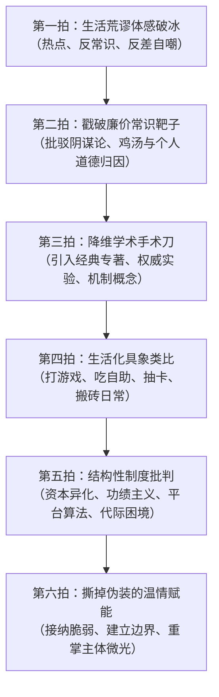
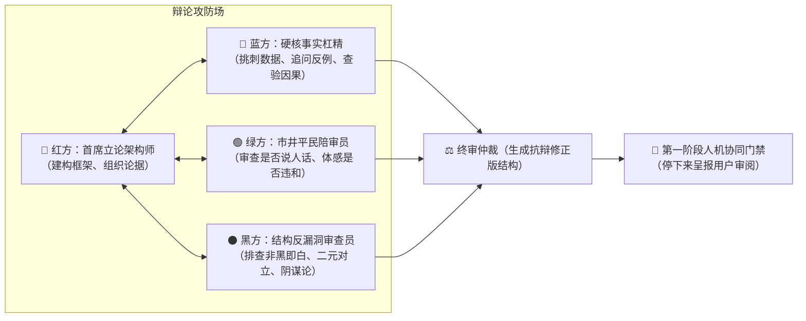

# 《围炉夜话》20篇长视频文案深度风格蒸馏与论据体系拆解报告

> **调研样本**：B站UP主“智能路障”代表作《围炉夜话》系列最新20期长视频深度文案（全量超22万字）  
> **研究目的**：全面蒸馏其文风内核、语言指纹、论据金字塔、叙事六拍节律，并提炼工业级复刻规范，为 `weiluyehua` Skill 的知识库与辩论攻击体系提供坚实底层支撑。

---

## 目录
1. [总纲：什么是《围炉夜话》的底层写作哲学？](#1-总纲什么是围炉夜话的底层写作哲学)
2. [语言风格指纹深度蒸馏（句式、语调与修辞）](#2-语言风格指纹深度蒸馏句式语调与修辞)
3. [叙事六拍律：20篇爆款长视频的标准节律结构](#3-叙事六拍律20篇爆款长视频的标准节律结构)
4. [20篇文案全景论据矩阵与逐篇深度拆解](#4-20篇文案全景论据矩阵与逐篇深度拆解)
5. [论据金字塔与跨学科理论库分类汇总](#5-论据金字塔与跨学科理论库分类汇总)
6. [多Agent红蓝对抗辩论与质检审查规范](#6-多agent红蓝对抗辩论与质检审查规范)

---

## 1. 总纲：什么是《围炉夜话》的底层写作哲学？

智能路障的《围炉夜话》绝非普通的“知识科普”，也不是居高临下的“精英说教”，更不是情绪宣泄式的“自媒体爽文”。通过对20篇全量文本的微观解剖，其核心底层哲学可概括为十二个字：

**“平民视角，学术手术刀，结构性慈悲。”**

### 1.1 三大核心支柱
1. **平民视角（去爹味、自嘲锚点）**：
   - 绝不以导师或先知自居。开篇往往亮出“普通打工人/中专生/网瘾少年”的自嘲底色（例如“作为一个学历普通、也没发过大财的普通人”、“老观众都知道我当年在网吧通宵打剑灵搬砖”）。
   - 与观众坐在一张破板凳上烤同一盆火，先认同普通人的软弱、困惑、虚荣和疲惫，建立不可动摇的情感同盟。
2. **学术手术刀（降维打击、机制剖析）**：
   - 当击碎廉价常识（如“你不努力”、“体制问题”、“都是资本家的阴谋”等粗糙归因）之后，绝不用新的情绪口号替代，而是掏出跨学科的严肃学术模型。
   - 引用伊恩·哈金的“概念蠕变”、韩炳哲的“爱欲之死与功绩社会”、齐格蒙特·鲍曼的“新穷人”、丹尼尔·卡尼曼的“双系统认知偏差”、基思·斯坦诺维奇的“理性与智力解耦”、查尔斯·汉迪的“三叶草组织模型”等。
   - 用严谨的社会学、认知科学、行为经济学原理解释生活荒谬感的成因。
3. **结构性慈悲（破除个人内耗，直面真实世界）**：
   - 拒绝廉价鸡汤。不轻浮地承诺“只要你读了这篇文章/学会这招就能发财逆袭”。
   - 将个体深陷的内耗痛苦，还原为宏观系统演进、资本积累模式、算法回音室或技术代际变迁的“结构性代价”。
   - 结局永远是“撕掉虚妄幻想之后的温柔拥抱”：认清生活的残酷与制度的局限，但在力所能及的原子化生活里，重拾微小的主体性与尊严。

---

## 2. 语言风格指纹深度蒸馏（句式、语调与修辞）

### 2.1 标志性句式指纹库
在20篇文案中，以下句式以极高频率出现，构成了智能路障鲜明的听觉与思维指纹：

| 句式类型 | 典型表达指纹 | 语用功能 |
| :--- | :--- | :--- |
| **破除廉价直觉** | “很多人第一反应往往是……但说句实话，这恰恰搞反了。”<br>“如果你把问题归结为……那你连大门都没摸到。” | 击碎受害者有罪论、阴谋论或偷懒归因 |
| **自嘲降维退让** | “老观众都知道，我既不是经济学家，也不是心理大师……”<br>“我们退一万步讲，就算真的是这样，结果又如何呢？” | 卸下知识分子的傲慢，防守反击，预留逻辑冗余 |
| **类比具象转换** | “这就像你玩网络游戏，策划把爆率调到了千分之一……”<br>“这本质上就是去吃自助餐，你拼命硬塞大闸蟹……” | 将晦涩抽象机制翻译为市井平民的肌肉记忆 |
| **冷峻机制揭示** | “你以为你是在消费商品，其实你本身就是被标价的商品。”<br>“平台算计的从来不是你的智商，而是人类演化了几十万年的多巴胺弱点。” | 揭露资本、算法或制度的暗线运转逻辑 |
| **温情收尾唤醒** | “认清这一点，不是为了让你绝望躺平，而是让你别再拿别人的尺子量自己的命。”<br>“回到开头那个问题，世界或许很烂，但今晚这炉火，属于我们自己。” | 提供情绪托底，重塑微观生活的主体性 |

### 2.2 类比三原则（把大词砸碎成砖头）
智能路障从不用晦涩术语堆砌学术逼格。每当抛出一个学术理论，必在两句话之内跟上一个生活类比：
- **原则一：消费与游戏映射**：将复杂的概率学/资本运转类比为《魔兽世界》《英雄联盟》《黑神话：悟空》打怪掉宝、抽卡保底、吃自助餐、买菜砍价。
- **原则二：生理与进化映射**：将心理防御机制、信息茧房类比为人体的“结痂”、远古智人躲避剑齿虎的应激反应。
- **原则三：职场与市井映射**：将社会学结构性压迫类比为“大厂外包工牌颜色不同”、“部门甩锅踢皮球”、“过年亲戚催婚催生”。

### 2.3 负向禁忌清单（绝对不能有的“AI味与爹味”）
- ❌ **严禁好为人师的说教腔**：严禁出现“你应该做到以下三点”、“我们要树立正确的人生观”、“作为年轻人必须明白”。
- ❌ **严禁廉价正能量鸡汤**：严禁出现“明天会更好”、“星光不问赶路人”、“相信光的人终会变成光”。
- ❌ **严禁粗糙的二极管归因**：严禁直接扣上“这届年轻人不行”、“资本家太坏了”、“全是算法作恶”的单向结论，必须展现两难困境与深层系统矛盾。
- ❌ **严禁生硬罗列学术参考文献**：书名和学者必须在叙事水流中自然浮现，作为“解答困惑的手术刀”，而非炫耀博学的装饰品。

---

## 3. 叙事六拍律：20篇爆款长视频的标准节律结构

20篇文案在结构组织上高度统一，呈现严谨的“叙事六拍律”递进节奏：



1. **第一拍【破冰】生活荒谬体感破冰（占比约 10%）**：
   - 用一个近期热议事件、荒诞现象或切身体感切入（如“为什么满大街都在造黑话”、“为什么明明没干体力活却累得像条狗”）。
   - 迅速亮出自嘲：“作为一个常常也想摆烂的普通人，我也曾经百思不得其解。”
2. **第二拍【破靶】戳破廉价常识归因（占比约 15%）**：
   - 树立大众最容易产生的粗浅判断（“有人说是现代人懒”、“有人说是资本家心黑”、“有人说是网络环境差”）。
   - 用严密反例或逻辑归谬法迅速拆解：“如果是这样，为什么三十年前没有？为什么高学历精英也深陷其中？”
3. **第三拍【降维】学术手术刀解剖（占比约 25%）**：
   - 引入 1~2 位该领域的权威学者及其经典著作与经典实验。
   - 拆解核心机理：不是名词背诵，而是清晰梳理“因为 A 机制导致了 B 条件，从而在人脑/社会中引发了 C 反应”。
4. **第四拍【翻译】生活化具象类比（占比约 20%）**：
   - 理论讲完后立即换挡，用打工人极其熟悉的生活场景或亚文化元素打比方，彻底化解理解门槛。
5. **第五拍【升维】结构性制度批判（占比约 20%）**：
   - 视角从微观个体或局部现象，拉升到现代社会的深层矛盾（效率至上的泰勒制、消费主义的符号陷阱、注意力经济的流量收割、功绩社会的自我剥削）。
6. **第六拍【落地】撕掉伪装的温情赋能（占比约 10%）**：
   - 不给虚妄的逆袭药方，而是真诚地给予心理减负：“允许自己停下来，做个自知自洽的普通人，比扮演一个全能战士重要得多。”

---

## 4. 20篇文案全景论据矩阵与逐篇深度拆解

本节对20篇全量长视频文案进行显微镜式的结构剖析，揭示其选题、常识靶子、学术论据、接地气类比与升华结语的完整脉络。

### 篇目 01：《贴标签、造黑话！现代人为何越来越不会说人话？》
- **字数规格**：12,194字
- **核心议题**：网络语言腐败、黑话泛滥与概念膨胀
- **廉价常识靶子**：以为是年轻人追求新潮、缩写好玩，或者语文水平退步。
- **降维学术手术刀**：
  1. **伊恩·哈金（Ian Hacking）《重写灵魂》**：“循环效应”（Looping Effect）与“制造人类”（Making Up People），指出分类学反过来塑造人类的自我感知。
  2. **尼克·哈斯拉姆（Nick Haslam）**：“概念蠕变”（Concept Creep），阐述创伤、霸凌、抑郁、自恋等临床心理学词汇从专业诊断滑落为泛化武器。
  3. **乔治·奥威尔（George Orwell）《政治与英语》《1984》**：“新话”（Newspeak）的本质不是丰富思想，而是消灭思考的复杂维度。
- **接地气生活类比**：
  - “就像打游戏给装备附魔，一个普普通通的人际摩擦，一旦贴上‘PUA’、‘自恋型人格障碍（NPD）’的标签，瞬间获得道德核弹的攻击加成。”
  - 将互联网吵架比作“拿着病历单互相甩脸子”。
- **升华落地**：呼吁警惕放弃精准表达后的思维懒惰，用具体的人和事对抗虚妄的概念高墙。

---

### 篇目 02：《商务漂流、擦边二游，现代人为何如此性压抑》
- **字数规格**：11,075字
- **核心议题**：性压抑、虚拟代偿与亲密关系解体
- **廉价常识靶子**：以为是道德风气保守，或者当代年轻人生理机能退化。
- **降维学术手术刀**：
  1. **韩炳哲《爱欲之死》**：他者的消失与彻底的自恋。爱欲需要向不可控的“他者”暴露脆弱，而消费社会将爱欲驯化为可预期的性商品。
  2. **齐格蒙特·鲍曼《液态之爱》**：液态现代性下的快餐式关系，人们渴望连接但恐惧纽带。
  3. **伊娃·易洛思（Eva Illouz）《爱的终结》**：资本主义情感生活中的情感资本主义与负面关系学。
- **接地气生活类比**：
  - 二次元手游的“媚宅”与“赛博老婆”就像“无糖可乐”——提供毫无卡路里负担的甜味刺激，却没有任何真实人际交往中不得不承受的摩擦与刺痛。
  - “商务漂流”如同买会员自动续费，随时可以一键退订。
- **升华落地**：指出真正的亲密绝非无菌实验室，敢于走出自恋温室、接纳真实的疼痛，才是爱与被爱的起点。

---

### 篇目 03：《黑哨、贿选、死人！世界杯到底黑到什么程度》
- **字数规格**：12,587字
- **核心议题**：国际体育政治、FIFA腐败体系与跨国资本暗流
- **廉价常识靶子**：单纯归咎于个别裁判缺德、个别官员贪婪受贿。
- **降维学术手术刀**：
  1. **跨国非政府组织治理失灵与瑞士协会法漏洞**：揭露国际足联作为“非营利组织”却垄断全球最庞大商业利益的制度套利机制。
  2. **地缘政治博弈与软实力洗白（Sportswashing）**：剖析卡塔尔申办过程中的天然气贸易合同、法国战机军售与投票换算链条。
  3. **外籍劳工制度（Kafala 赞助制）**：解剖巨型场馆建设背后数千外劳生命代价的制度化人权真空。
- **接地气生活类比**：
  - 将国际足联主席大选比作“村委会选举发鸡蛋”，只不过台下的鸡蛋换成了几十亿美元的石油基建和军火大单。
  - 将裁判黑哨比作“赌场荷官奉旨洗牌”。
- **升华落地**：足球是普通人热爱的童话，但资本和政治把它变成了巨富阶层的提款机与赎罪券；看清肮脏的底色，依旧能纯粹地为那颗滚动的皮球热泪盈眶。

---

### 篇目 04：《世界杯来了，赌狗也来了》
- **字数规格**：8,125字
- **核心议题**：博彩底层数学逻辑、赌徒认知偏差与多巴胺操纵
- **廉价常识靶子**：以为自己懂球、有内幕消息、技术分析到位就能赢庄家。
- **降维学术手术刀**：
  1. **博彩赔率精算与水钱（Vigorish）机制**：严格数学证明无论比赛结果如何，庄家通过盘口微调早已锁定确定性无风险利润。
  2. **近失效应（Near-Miss Effect）与变额比率强化**：行为神经科学揭示，射中门框的“差一点就中”比直接输掉更让人多巴胺狂飙。
  3. **赌徒谬误与虚假控制感（Illusion of Control）**：将随机概率事件误判为有规律的必然事件。
- **接地气生活类比**：
  - “你以为你是在跟对面的球迷猜输赢，其实你是去澳门赌场跟开赌场的何鸿燊玩投硬币，而且每投一次都要交10%的手续费。”
- **升华落地**：唯一稳赚不赔的策略就是永远不下场，别拿自己有限的血汗钱去对抗拥有无限弹药的精算大厦。

---

### 篇目 05：《这时代，阅读还有未来吗》
- **字数规格**：8,261字
- **核心议题**：数字媒介演进、神经可塑性与深阅读能力的瓦解
- **廉价常识靶子**：以为是当代人心浮气躁、读书没用，或者纸质书形式落后。
- **降维学术手术刀**：
  1. **玛丽安娜·沃尔夫（Maryanne Wolf）《阅读的脑》**：人类大脑并没有先天的阅读基因，阅读回路是高度脆弱的后天神经重塑产物。
  2. **尼古拉斯·卡尔（Nicholas Carr）《浅薄》**：超链接、屏幕快读与碎片化信息正在将人类大脑格式化为“F型快速扫视”的冲浪机器。
  3. **深阅读（Deep Reading）中的批判性思维与共情中枢阻断**。
- **接地气生活类比**：
  - 刷短视频和看爽文，就像在脑子里“无限注水”；而读严肃书籍，就像在脑子里“人工挖渠”。水注得再多，没有水渠也只是烂泥塘。
- **升华落地**：阅读不是高人一等的装腔利器，而是当算法试图把你喂养成无意识的数据饲料时，你给自己留的一道精神防空洞。

---

### 篇目 06：《做题能改变命运吗》
- **字数规格**：10,570字
- **核心议题**：应试教育范式与现代社会真实生存法则的脱节
- **廉价常识靶子**：“做题无用论”或“一考定终身神话”两个极端的互搏。
- **降维学术手术刀**：
  1. **丹尼尔·卡尼曼《思考，快与慢》**：做题训练的是确定性规则下的系统2闭卷检索能力，而现实生活是充满概率、不确定性与非线性反馈的混沌系统。
  2. **教育社会学中的“文化资本”传递（布尔迪厄）**。
  3. **非遍历性系统（Non-ergodic System）风险**：一次致命做题失误不等于人生归零，但现实商业博弈中一次暴雷可能永远出局。
- **接地气生活类比**：
  - “做题就像驾校学车，考的是看倒车镜里的一根线；真实的人生是下暴雨在没有车道线的悬崖盘山公路上开大货车。”
- **升华落地**：做题是普通人能够拿到的最低成本的入场券，但上岸之后，你必须尽快丢掉那根考卷给你的拐杖，学会亲自用双手趟水。

---

### 篇目 07：《好学生和差学生的区别在哪》
- **字数规格**：6,344字
- **核心议题**：认知科学视角下的学习本质与心智模型差异
- **廉价常识靶子**：归结于智商高低、努力时间长短或“态度不端正”。
- **降维学术手术刀**：
  1. **丹尼尔·威林厄姆（Daniel T. Willingham）《为什么学生不喜欢上学？》**：大脑不是用来思考的，大脑是用来避免思考的；思考是缓慢且痛苦的。
  2. **工作记忆（Working Memory）容量瓶颈与组块化（Chunking）**：学霸的优势在于将基础知识自动化沉淀到长期记忆，从而释放宝贵的工作记忆用于高级整合。
  3. **知识的深层结构（Deep Structure）vs 表面特征（Surface Feature）**。
- **接地气生活类比**：
  - 差生做题像背地图上的每一棵树，走两步就迷路；好学生做题是脑子里有卫星高德导航，看一眼路口就知道通向哪条高速。
- **升华落地**：不要陷入感动自我的低水平勤奋，把精力花在建立核心概念的骨架上。

---

### 篇目 08：《自由职业真相：不上班，到底应该怎么活》
- **字数规格**：10,765字
- **核心议题**：零工经济、独立从业者的现实代价与自律悖论
- **廉价常识靶子**：自由职业就是睡到自然醒、环游世界做数字游民的诗与远方。
- **降维学术手术刀**：
  1. **查尔斯·汉迪（Charles Handy）《三叶草组织》**：核心管理层、外包合同商与弹性临时工的三分天下，自由职业本质上是公司将固定成本转化为弹性外包风险的产物。
  2. **自律税与认知负荷暴增**：上班时组织为你承担了时间表、财务和客户对接，自由职业意味着你一个人要同时兼任总经理、销售员、清洁工和讨债人。
  3. **社保与抗周期能力的制度性脱节**。
- **接地气生活类比**：
  - 搬砖打工就像在动物园里被关在笼子里，虽然不自由但每天固定有饲料；自由职业是把你扔到非洲大草原上，虽然没了栅栏，但每一口吃的都得跟狮子鬣狗抢。
- **升华落地**：真正的自由不是想干什么就干什么，而是拥有对不想干的事情说“不”的能力和底气。

---

### 篇目 09：《扎心的真相：上班是如何摧毁我们的心态、生活和幸福感的》
- **字数规格**：7,181字
- **核心议题**：职场劳动异化、情绪劳动与现代白领的无意义感
- **廉价常识靶子**：都怪老板太黑心、公司文化狼性，或者打工人抗压能力差。
- **降维学术手术刀**：
  1. **卡尔·马克思《1844年经济学哲学手稿》中的异化劳动（Alienation）**：人同自己的劳动产品、劳动过程、类本质乃至他人的四重疏离。
  2. **大卫·格雷伯（David Graeber）《狗屁工作》（Bullshit Jobs）**：现代官僚制为了自我维系而繁殖出的大量无意义工种（看门人、打手、拼凑者）。
  3. **阿莉·霍克希尔德《心灵的整饰》中的情绪劳动（Emotional Labor）**。
- **接地气生活类比**：
  - “就像你在流水线上拧螺丝，你不知道这个零件装在飞机上还是拖拉机上；更恶心的是，你还得微笑着给螺丝点赞，并写一份周报论述这颗螺丝如何赋能全球业务。”
- **升华落地**：把工作降级为一手交钱一手交货的契约，在打卡下班的那一秒彻底夺回属于自己的灵魂。

---

### 篇目 10：《为什么谈恋爱这么难》
- **字数规格**：7,044字
- **核心议题**：当代亲密关系的心理机制与依恋障碍
- **廉价常识靶子**：归咎于彩礼高、男女对立严重、或者是“遇不到对的人”。
- **降维学术手术刀**：
  1. **约翰·鲍尔比（John Bowlby）与玛丽·安斯沃思（Mary Ainsworth）的依恋理论（Attachment Theory）**：安全型、焦虑型、回避型与恐惧回避型。
  2. **阿米尔·莱文（Amir Levine）《亲密关系与情感依赖》**：焦虑型与回避型的“追逃死循环”（Anxious-Avoidant Trap）。
  3. **心理学投射认同（Projective Identification）**。
- **接地气生活类比**：
  - 焦虑型谈恋爱像抓着风筝线死命往回扯，生怕断了；回避型像缩头乌龟，对方一敲门就立刻把脑袋缩进铁壳里。两个人撞在一起就像一个天天去砸门，一个天天在门后焊钢板。
- **升华落地**：先看清自己原生模式里的防御盔甲，不把伴侣当成拯救自己匮乏的药，才能建立真正的双向共鸣。

### 篇目 11：《怎么判断自己是不是一个聪明人》
- **字数规格**：11,044字
- **核心议题**：智商（IQ）与理性商（RQ）的解耦、反思心智与心智程序缺陷
- **廉价常识靶子**：以为做智力测验分数高、学历高、记性好、反应快就是聪明。
- **降维学术手术刀**：
  1. **基思·斯坦诺维奇（Keith E. Stanovich）《超越智商：为什么聪明人会做蠢事》**：区分三重心智模型（自主心智、算法心智、反思心智）。高IQ只能保证算法心智的高效运转，而理性决策完全取决于反思心智的压制能力。
  2. **心智程序缺陷（Mindware Gap）与污染的心智程序**：伪科学、迷信与极端意识形态如何寄生在高智商宿主身上。
  3. **丹尼尔·卡尼曼与阿莫斯·特沃斯基的认知偏差理论**。
- **接地气生活类比**：
  - 智商高就像一台配备了顶级英伟达显卡的电脑主机，算力极强；而理性商决定了你装的是Windows正版系统，还是装了一堆挖矿木马全家桶。算力越强的电脑，挖起木马来跑得比谁都快。
- **升华落地**：真正的聪明不是知道自己有多牛，而是对自身认知的局限性抱有终生的敬畏与诚实。

---

### 篇目 12：《毒害年轻人的错误认知有哪些》
- **字数规格**：9,470字
- **核心议题**：幸存者偏差、鲜活性效应与伪因果关系的认知排毒
- **廉价常识靶子**：盲信暴富神话、成功人士传记、经验主义民间土方。
- **降维学术手术刀**：
  1. **基思·斯坦诺维奇《这才是心理学》**：科学实证的四大金科玉律——可证伪性（Falsifiability）、操作主义、控制组对照与概率思维。
  2. **鲜活性效应（Vividness Effect）**：生动具体的个案（如买彩票中大奖的邻居）往往会摧毁人脑对冰冷统计大数定律的感知。
  3. **确认偏误（Confirmation Bias）与事后诸葛亮偏见**。
- **接地气生活类比**：
  - “去寺庙烧香求生儿子，灵了的人敲锣打鼓送锦旗，不灵的人悄悄回家闭嘴不谈，最后寺庙墙上挂满了‘有求必应’的锦旗。”
- **升华落地**：学会用统计学的眼光看世界，是现代人防割韭菜、防被PUA最便宜的铠甲。

---

### 篇目 13：《年轻人为何越来越疲惫、焦虑》
- **字数规格**：9,094字
- **核心议题**：功绩主义神话破灭、自我剥削与过度竞争的内卷之痛
- **廉价常识靶子**：怪罪年轻人不能吃苦、躺平摆烂、精神脆弱。
- **降维学术手术刀**：
  1. **迈克尔·桑德尔（Michael J. Sandel）《精英的傲慢：好的社会该如何定义成功》**：优绩制（Meritocracy）的残酷谎言——成功者将运气归功于个人能力从而傲慢无礼，失败者将时代的系统性惩罚归咎于自身无能从而陷入深重自责。
  2. **韩炳哲《倦怠社会》**：从福柯的规训社会（禁止与惩罚）转向功绩社会（你可以、你能行）。自我剥削比被他人剥削更具毁灭性，因为剥削者与受害者合二为一。
- **接地气生活类比**：
  - 就像在电影院看电影，前排的人站起来了，后排的人为了看见也只能站起来，最后全场观众站得腰酸背痛，看到的画面却和坐着时一模一样，但谁也不敢先坐下。
- **升华落地**：当系统不断告诉你“你还可以更优秀”时，敢于对自己说一句“我已经够好了”，就是最壮烈的反抗。

---

### 篇目 14：《都在劝你多存钱，但我想劝你多花钱》
- **字数规格**：7,980字
- **核心议题**：时间与健康资本的折现、经验效用曲线与人生财富最优解
- **廉价常识靶子**：传统苦行僧式的盲目储蓄、省吃俭用熬到退休再享福。
- **降维学术手术刀**：
  1. **比尔·柏金斯（Bill Perkins）《最优解人生（Die with Zero）》**：金钱的本质是用来兑换人生体验的代币。体验具有时间敏感性与记忆股息（Memory Dividends）。
  2. **效用折现理论与健康资本衰减函数**：20岁去背登山包徒步西藏的体验效用，与70岁坐轮椅去吸氧的体验效用存在本质差异。
- **接地气生活类比**：
  - “玩单机RPG游戏，你抠搜了一辈子舍不得吃血药、舍不得用强力法杖，背包里攒了999个顶级灵药，结果打通关滚字幕了，那些灵药全变成了一堆废弃代码。”
- **升华落地**：该花的钱是对生命密度的投资；让每一分钱在身体机能最饱满的岁月里绽放，而不是留在银行账户上变成遗产分割案的案卷。

---

### 篇目 15：《为何世道从未太平，恶人总是横行无忌》
- **字数规格**：8,485字
- **核心议题**：反社会人格机制、黑暗三联征与道德底线的非对称性
- **廉价常识靶子**：天真以为“善有善报恶有恶报”，或者以为恶人只是受了苦衷、可以被感化。
- **降维学术手术刀**：
  1. **玛莎·斯托特（Martha Stout）《当良知沉睡》（The Sociopath Next Door）**：人群中存在约4%的无良知者（反社会人格倾向），他们大脑杏仁核与边缘系统对他人痛苦没有生理层面的共情神经反射。
  2. **黑暗三联征（Dark Triad）**：马基雅维利主义（冷酷操纵）、自恋型人格、心理变态。
  3. **博弈论中的非对称博弈**：守规则的人受道德与法律双重约束，破规则的人把道德当成攻击守规则者的杠杆。
- **接地气生活类比**：
  - 就像两个人在擂台上打拳击，正人君子严格遵守规则不出阴招，而恶徒裤裆里藏了石灰粉和扳手，趁你不备就往你眼睛上扬。
- **升华落地**：保持善良，但必须给善良装上獠牙；看清恶的本质，才能在深渊面前保护好自己和真正在乎的人。

---

### 篇目 16：《消费主义的本质：花钱你会成为穷人，抠门你会成为新穷人》
- **字数规格**：10,769字
- **核心议题**：齐格蒙特·鲍曼“新穷人”理论、符号消费与社会身份流放
- **廉价常识靶子**：要么怪年轻人虚荣爱买奢侈品，要么觉得只要存钱极简就能摆脱消费主义控制。
- **降维学术手术刀**：
  1. **齐格蒙特·鲍曼《工作、消费主义和新穷人》**：从“生产者社会”向“消费者社会”的范式转变。在过去，穷人是因为没有工作；在今天，穷人是因为失去了消费能力而成为“有瑕疵的消费者”（Defective Consumers）。
  2. **让·鲍德里亚《消费社会》**：人们消费的从来不是物品的使用价值，而是物品所背书的阶层符号与社会区分（Distinction）。
  3. **凡勃伦《有闲阶级论》中的炫耀性消费（Conspicuous Consumption）**。
- **接地气生活类比**：
  - 消费社会就像一趟永不停歇的跑步机，广告商把终点线画在永远追不上的前方；你拼命跑会被累死，你停下来不跑就会被甩到履带外面，并被周围的人指责为“跟不上时代的老古董”。
- **升华落地**：认清符号的虚妄，在消费主义的洪流中守住自己内心真正珍视的生活秩序。

---

### 篇目 17：《网络喷子和键盘侠这么多，罪魁祸首到底是谁》
- **字数规格**：9,352字
- **核心议题**：去个体化匿名效应、部落主义道德极化与社交平台算法暗流
- **廉价常识靶子**：以为是网民素质普遍低下，或者单纯是平台审核不力。
- **降维学术手术刀**：
  1. **克里斯·拜尔（Chris Bail）《打破社交媒体棱镜》**：社交网络不是展现真实的镜子，而是一面棱镜，它放大了两极极端的喧嚣，压制了温和理性的沉默大多数。
  2. **社会心理学中的“去个性化”（Deindividuation）与匿名效应（Gustave Le Bon）**。
  3. **道德部落主义（Moral Tribalism）与愤怒经济学（Outrage Economy）**：平台的推荐算法把“诱发道德愤怒”作为延长用户留存时长的最高权重指标。
- **接地气生活类比**：
  - 互联网评论区就像古罗马斗兽场，平台是卖门票的老板，它拼命把两头饿红了眼的斗牛关在同一个铁笼子里，越是血肉横飞，台下的看客越多，爆米花卖得越贵。
- **升华落地**：不在别人的斗兽场里当免费小丑；关闭评论区，把注意力赎回给现实世界中的一蔬一饭。

---

### 篇目 18：《摆拍，编剧本，网红上热搜，短视频是怎样恶心全国的》
- **字数规格**：7,249字
- **核心议题**：伪事件、超真实（Hyperreality）与算法审美的剧场效应
- **廉价常识靶子**：以为网红摆拍只是个人道德问题，过一阵子大家看穿了就会自觉抵制。
- **降维学术手术刀**：
  1. **丹尼尔·布尔斯廷（Daniel J. Boorstin）《幻象：美国伪事件指引》**：大众不再关心事件是否真实发生，只关心它是否足够具有戏剧冲击力。“伪事件”通过自我指涉彻底吞噬了真实生活。
  2. **让·鲍德里亚《拟像与仿真》**：仿真取代了现实，影像比现实本身更“真实”。
  3. **剧场效应与劣币驱逐良币机制**：真实生活往往平淡碎屑，在争夺秒级完播率的算法赛道上注定惨败给精心编排的情绪剧本。
- **接地气生活类比**：
  - 就像菜市场卖西瓜，老实本分的瓜农切开熟瓜让人尝，旁边的人却用色素、糖精和膨大剂做了一个发光塑料西瓜，敲一敲还会放摇滚乐，结果所有人都围在塑料西瓜前拍照，真瓜全烂在框里。
- **升华落地**：当全世界都在用剧本演戏时，对真实生活的细颗粒度感知，成了当代人最稀缺的审美能力。

---

### 篇目 19：《如何使内心强大？解析当代年轻人的九大心理防御机制》
- **字数规格**：11,637字
- **核心议题**：精神分析学派的防御机制谱系、心理结痂与成熟人格塑造
- **廉价常识靶子**：以为内心强大就是“死扛”、“打碎牙齿和血吞”或者“盲目自嗨正能量”。
- **降维学术手术刀**：
  1. **西格蒙德·弗洛伊德与安娜·弗洛伊德《自我与防御机制》**。
  2. **九大防御机制阶梯式全解**：
     - *不成熟/病理性防御*：否认（Denial）、分裂（Splitting）、投射（Projection）；
     - *神经症性防御*：压抑（Repression）、反向形成（Reaction Formation）、理智化（Intellectualization）、置换（Displacement）；
     - *成熟/高级防御*：升华（Sublimation）、幽默（Humor）。
  3. **乔治·瓦利恩特（George Vaillant）成人发展研究**。
- **接地气生活类比**：
  - 心理防御机制就像人体免疫系统发烧和皮肤结痂。结痂是为了保护伤口免受感染，但如果你把自己包裹在一个厚重的水泥棺材里，伤口是碰不到了，人也憋死了。
- **升华落地**：内心的强大不是刀枪不入，而是即使伤痕累累、即便手抖得厉害，依然能调侃一句，然后坦然站起来往前走。

---

### 篇目 20：《为什么互联网越来越低智，回旋镖越来越多》
- **字数规格**：24,521字（长篇年终巨献）
- **核心议题**：公共讨论崩溃、极化认知闭合、复杂系统与信息熵增
- **廉价常识靶子**：以为是某些人群智力退化，或者是单纯的立场屁股问题。
- **降维学术手术刀**：
  1. **控制论与复杂适应系统（Complex Adaptive Systems）**：系统内部要素非线性耦合，简单线性的因果归因必然在动态演化中遭遇“回旋镖效应”。
  2. **认知闭合需要（Need for Cognitive Closure, NFCC）**：当外界不确定性暴增时，大脑会产生对确定性、简单粗暴标签的病态渴求。
  3. **公共政策与财政机制实证**：引用《深圳特区个人破产条例》、中央地方财政事权支出责任划分、统一电力市场建设等顶层设计文件，展示真实制度治理的千头万绪与多难权衡。
- **接地气生活类比**：
  - 互联网吵架就像小孩子看动画片，非要问“这个是好人还是坏人”；而真实的现实世界是一张盘根错节的全国电网，拉下一根电闸，连带跳闸的可能是十个省份的民生供暖。
- **升华落地**：拒绝非黑即白的二极管脑回路，承认世界的复杂性与不确定性，是现代文明公民最基础的尊严。

---

## 5. 论据金字塔与跨学科理论库分类汇总

从这20篇长文中可以清晰抽象出《围炉夜话》的“三层论据金字塔”架构：

```
                    ▲
                   / \  【顶层：硬核学术与机制底座】（权威专著、经典心理学/社会学实验、顶层制度法规）
                  /   \
                 /-----\ 【中层：统计实证与微观机制】（行为经济学偏差、精算模型、概率悖论、算法逻辑）
                /       \
               /---------\ 【底层：平民体感与市井类比】（UP主自嘲、单机网游打宝、吃自助餐、买菜挤地铁）
```

### 5.1 跨学科理论与书单矩阵（高频弹药库）

| 学科领域 | 核心学者与代表作 | 经典模型 / 概念武器 | 适用议题 |
| :--- | :--- | :--- | :--- |
| **社会学与批判理论** | 齐格蒙特·鲍曼《工作、消费主义和新穷人》《液态之爱》<br>韩炳哲《爱欲之死》《倦怠社会》<br>让·鲍德里亚《消费社会》《拟像与仿真》 | 新穷人、液态现代性、他者的消亡、功绩社会自我剥削、符号消费、拟像超真实 | 消费主义、性压抑、职场倦怠、短视频摆拍、社会不公 |
| **认知科学与理性心理学** | 丹尼尔·卡尼曼《思考，快与慢》<br>基思·斯坦诺维奇《超越智商》《这才是心理学》<br>丹尼尔·威林厄姆《为什么学生不喜欢上学？》 | 双系统模型、心智程序缺陷、理性商RQ解耦、工作记忆瓶颈与组块化、可证伪性 | 学习方法、做题家困局、智商陷阱、认知偏差、伪科学辨析 |
| **社会心理学与精神分析** | 弗洛伊德 & 安娜·弗洛伊德《自我与防御机制》<br>约翰·鲍尔比 & 玛丽·安斯沃思（依恋理论）<br>尼克·哈斯拉姆（概念蠕变）<br>玛莎·斯托特《当良知沉睡》 | 九大防御机制、焦虑/回避型依恋循环、概念蠕变（横向/纵向）、反社会人格无良知机制 | 亲密关系、内心强大、网络黑话、职场PUA、恶人横行现象 |
| **媒介社会学与传播学** | 尼古拉斯·卡尔《浅薄》<br>玛丽安娜·沃尔夫《阅读的脑》<br>克里斯·拜尔《打破社交媒体棱镜》<br>丹尼尔·布尔斯廷《幻象：美国伪事件指引》 | 神经可塑性回路瓦解、F型扫视、社交棱镜极化、伪事件自我指涉、愤怒经济学 | 数字阅读消亡、网络喷子与键盘侠、网红经济、信息茧房 |
| **政治哲学与公共制度** | 迈克尔·桑德尔《精英的傲慢》<br>查尔斯·汉迪《三叶草组织》<br>卡尔·马克思《1844年经济学哲学手稿》<br>公共政策与破产/电力法案实证 | 优绩主义批判、三叶草弹性用工、四重劳动异化、复杂适应系统非线性耦合 | 年轻人焦虑、自由职业真相、上班致郁、互联网回旋镖 |

### 5.2 论据检索与评估四大标准（用于第一阶段 Agent）
在网上检索与评估论据时，严禁使用粗制滥造的二手自媒体文章，必须遵循以下四大门禁：
1. **源头权威性（学术溯源）**：优先采纳发表于 Peer-reviewed 期刊的元分析（Meta-analysis）、经典大学出版社专著（如牛津、剑桥、哈佛）、权威科研机构报告。
2. **逻辑穿透力（机制优于结论）**：不仅给出“是什么”，必须穿透到“为什么”和“传导链条”（A怎样经由中介变量M影响到B）。
3. **经验可感性（生活锚点）**：论据必须能够无缝转化为打工人、学生党或普通市民能够感同身受的生动隐喻。
4. **反脆弱性（经得起杠精推敲）**：论据必须具备边界条件，明确其适用范围，不搞普遍主义的绝对化断言。

---

## 6. 多Agent红蓝对抗辩论与质检审查规范

为了彻底根除自媒体常见的“自圆其说、立稻草人、逻辑滑坡、偷换概念”等毛病，《围炉夜话》的创作必须经历严格的**多 Agent 红蓝对抗辩论机制**：



### 6.1 四方角色与审议职责
1. **🔴 红方（首席立论架构师）**：
   - 职责：根据用户选题与初步论据，提出“反常识核心论点”与“叙事六拍大纲”，搭建初步论证骨架。
2. **🔵 蓝方（硬核事实杠精 / 严苛反方）**：
   - 职责：专门挑刺。追问“这个数据是真的吗？有没有可能只是个案？”、“该理论在学界是否存在重大争议？”、“有没有强有力的反例足以推翻因果链条？”
3. **🟢 绿方（市井平民陪审员 / 接地气体验官）**：
   - 职责：专查“爹味”与“黑话”。追问“这段话普通人听得懂吗？是不是在卖弄术语？”、“这个类比贴切吗？是不是脱离了打工人的真实生活体感？”
4. **⚫ 黑方（结构反漏洞审查员 / 深度哲学家）**：
   - 职责：专查“二极管思维”。追问“是不是在立稻草人批判？”、“有没有滑入非黑即白的民粹情绪或阴谋论？”、“有没有给复杂系统留出审慎的灰色地带？”

### 6.2 攻防质检输出规范
在第一阶段向用户呈报时，必须展示完整的四方攻防记录摘要，格式必须包含：
- **【核心立论】**（一句话颠覆性洞见）
- **【六拍骨架与论据矩阵】**（每小节的主题、学术工具刀、接地气类比）
- **【红蓝交锋攻防记录】**（蓝方提出的 2~3 个致命漏洞，以及红方如何调整论据或补充边界条件）
- **【平民体感审查意见】**（绿方指出的术语下沉建议）
- **【呈报用户决策清单】**（列出需要用户确认、增删或拍板的核心分歧点，等待用户指令）
